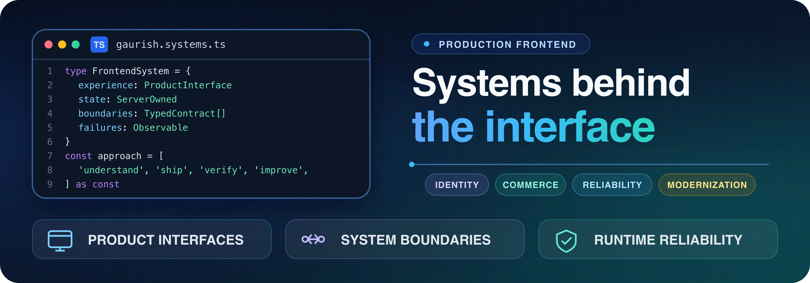

  

  
  
  
  

## Frontend & product engineering

I’m Gaurish. I build web applications with **React, TypeScript, and Node.js**. My work has ranged from analytics dashboards in React and D3 to a Next.js marketplace for vehicle discovery, bookings, and payments. I like owning a feature across the UI and API, especially when a request can fail halfway through or a user’s permissions can change between visits.

At Anatta, I built and operated a **blue-green release pipeline** on Fly.io with GitHub Actions. It promotes the same Docker image accepted in pre-production, checks the running fleet, and records the previous image for rollback. I used it for a production cutover after rehearsing rollback. For day-to-day development, I expanded pull-request previews so QA could test the intended revision and data profile.

On the product side, I built location-scoped order details, wholesale reorder, and B2B location management. I worked with UI architects to ship Remix 2 and Vite across 74 routes, then implemented the React Router 7 and Hydrogen migration on the existing Express host. Account and checkout flows passed in preview. The release is in review.

## Engineering notes from production

- **[Customer identity migration](https://gaurishsaini.hashnode.dev/shopify-customer-accounts-migration-headless-storefront)** — how we kept accounts and carts in sync when OAuth refreshed a session during a redirect.
- **[Pull-request previews on Fly.io](https://gaurishsaini.hashnode.dev/pr-previews-flyio-domains-data-profiles)** — how a reviewer’s preview URL resolves to the code, domain, and data profile they intend to test.
- **[Checkout-safe cart flows](https://gaurishsaini.hashnode.dev/checkout-safe-cart-flows-headless-shopify)** — which edits can be replayed after a cart expires and why checkout waits until the correct buyer identity is in place.

## Public projects

In my **[conversational AI CLI](https://github.com/gaurish-saini/agents-v2)**, I implemented approval controls for file tools, cancellation, and timeouts. The [multi-turn evaluations](https://github.com/gaurish-saini/agents-v2/tree/master/evals) run the same agent loop as the CLI with deterministic test tools. They check tool selection and call order, including cases where a tool should stay unused.

In **[Buywind](https://github.com/gaurish-saini/ecommerce-dashboard-react)**, I built a React dashboard with a searchable, sortable order table and keyboard navigation. The repository includes the source and sample data.

Earlier, at ColoredCow, I worked on the team’s open-source portal. My contributions included [project-resource relationships](https://github.com/ColoredCow/portal/pull/888) and [repository links on project pages](https://github.com/ColoredCow/portal/pull/914).
